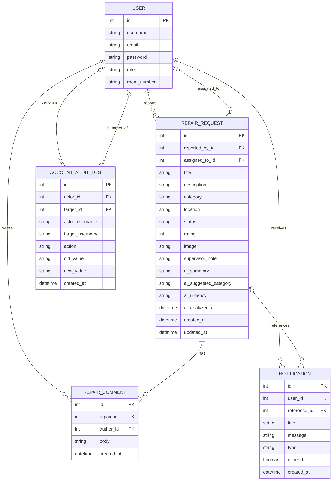

# DormFix ER Diagram

This diagram is based on the Django models in `accounts/models.py` and
`repairs/models.py`. It shows the application's main entities and relationships;
Django's built-in authentication tables and fields are omitted for clarity.

If the Mermaid preview appears blank, open the [standalone SVG diagram](./DORMFIX_ER_DIAGRAM.svg).

`assigned_to_id`, `reference_id`, `actor_id`, and `target_id` may be empty.
Passwords are stored as hashes by Django, not as plain text.
